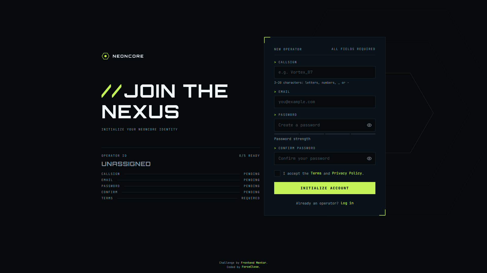

# Frontend Mentor - Gamer sign-up form solution

This is a solution to the [Gamer sign-up form challenge on Frontend Mentor](https://www.frontendmentor.io/challenges/gamer-sign-up-form). NEONCORE is a competitive-gaming network, and this project is its operator registration screen: a real, accessible sign-up flow with live validation, a password strength meter, a live Operator ID readout, and email/password authentication backed by a database.

<div align="center">
  <a href="https://tanstack.com/start/latest">
    <picture>
      <source media="(prefers-color-scheme: dark)" srcset="https://shieldcn.dev/badge/Tanstack%20Start.svg?theme=green&amp;logo=tanstack&amp;mode=dark">
      
    </picture>
  </a>
  <a href="https://www.solidjs.com/">
    <picture>
      <source media="(prefers-color-scheme: dark)" srcset="https://shieldcn.dev/badge/Solid.svg?theme=blue&amp;logo=solid&amp;mode=dark">
      
    </picture>
  </a>
  <a href="https://www.typescriptlang.org/">
    <picture>
      <source media="(prefers-color-scheme: dark)" srcset="https://shieldcn.dev/badge/TypeScript.svg?brand=typescript&amp;mode=dark">
      
    </picture>
  </a>
  <a href="https://tailwindcss.com/">
    <picture>
      <source media="(prefers-color-scheme: dark)" srcset="https://shieldcn.dev/badge/Tailwind%20CSS.svg?brand=tailwindcss&amp;mode=dark">
      
    </picture>
  </a>
</div>

## Table of contents

- [Overview](#overview)
  - [Features](#features)
  - [Screenshot](#screenshot)
  - [Links](#links)
- [My process](#my-process)
  - [Built with](#built-with)
  - [Running locally](#running-locally)
  - [Useful resources](#useful-resources)
  - [AI Collaboration](#ai-collaboration)
- [Author](#author)

## Overview

### Features

- **Live field validation**: Callsign, email, password, password confirmation, and terms are validated with Zod. Errors appear after blur or submit and clear as soon as the value becomes valid.
- **Password strength meter**: Four segments labelled Weak, Fair, Good, and Strong update from the first keystroke based on length, casing, numbers, and symbols.
- **Password rules popover**: A live checklist of the password requirements appears while the password field is focused.
- **Caps Lock warning**: Each field has a Caps Lock hint appears while it is active.
- **Show/hide password**: Each password field has an eye toggle.
- **Live Operator ID readout**: On desktop, the side panel tracks how many of the five fields are ready, shows per-field status, and displays the callsign as it is typed.
- **Clear submit states**: The button shows a transmitting state while submitting, the form is replaced by a success panel on completion, and an invalid submit shakes the panel and focuses the first invalid field.
- **Real authentication**: Better Auth handles email/password sign-up and login with a username plugin, sessions, and an `acceptTerms` user field persisted through Drizzle ORM to Neon Postgres.
- **Accessible by design**: Semantic labels, `aria-invalid`, error associations through Base UI Field, visible focus styles, keyboard-only operation, Caps Lock feedback, and focus management on invalid submit.
- **Protected flows and toasts**: Login redirects to a protected welcome screen, and success or failure toasts report authentication results.
- **Responsive, themed UI**: The fluid two-panel desktop layout collapses for mobile.

### Screenshot



### Links

- Solution URL: [solution URL](https://www.frontendmentor.io/solutions/neoncore-gamer-sign-up-form-solidjs-tanstack-start-typescript-uB5LeSAiNs)
- Live Site URL: [live site URL](https://gamer-sign-up-form.forceclose.workers.dev/signup)

## My process

### Built with

- [Solid](https://www.solidjs.com/)
- [TypeScript](https://www.typescriptlang.org/)
- [TanStack Start](https://tanstack.com/start/latest)
- [TanStack Form](https://tanstack.com/form/latest)
- [TanStack Store](https://tanstack.com/store/latest)
- [Tailwind CSS](https://tailwindcss.com/)
- [Better Auth](https://www.better-auth.com/)
- [Drizzle ORM](https://orm.drizzle.team/)
- [Neon](https://neon.tech/)
- [Zod](https://zod.dev/)
- [Kobalte](https://kobalte.dev/)
- [Base UI Solid](https://base-ui-solid.msviderok.com/)

### Running locally

This project uses pnpm, a Neon Postgres database, Drizzle, and Better Auth.

1. Install dependencies.

   ```bash
    pn i
   ```

2. Rename `.env.example` to `.env` and add all the required environment variable.
3. Run the database migrations.

   ```bash
    pn db:migrate
   ```

4. Start the dev server.

   ```bash
    pn dev
   ```

### Useful resources

- [TinyPNG](https://tinypng.com/) - image compression
- [Cloudinary](https://cloudinary.com/) - image hosting for og image
- [Perfect Pixel](https://www.welldonecode.com/perfectpixel/) - _pixel-perfect_ design overlay
- [Fluid Typography Calculator](https://royalfig.github.io/fluid-typography-calculator/) - fluid typography calculator
- [Fontsource](https://fontsource.org/) - Font provider

### AI Collaboration

I used an AI coding assistant as a learning partner throughout this challenge, not as an autopilot. It helped me understand unfamiliar APIs, review my approach, trace bugs, and work through deployment issues while I made the implementation decisions and wrote the code.

**How I used it:**

- **README Documentation**: Refined the features, what I learned, and continued development sections to ensure clear, concise, and well-structured documentation.
- **Cloudflare deployment debugging**: Traced pnpm workspace and SSR bundling failures, a missing `packages` field, a conflicting Nitro adapter, and Base UI's `browser` export condition loading client code on the server, then verified the fixes with local builds and Wrangler dry runs.

Collaborating with the AI helped me debug faster and keep the documentation clear, while I stayed responsible for the final implementation.

## Author

- GitHub - [Force Close](https://github.com/forceclosee)
- Frontend Mentor - [@forceclosee](https://www.frontendmentor.io/profile/forceclosee)
- X - [@forceclosee](https://x.com/forceclosee)
